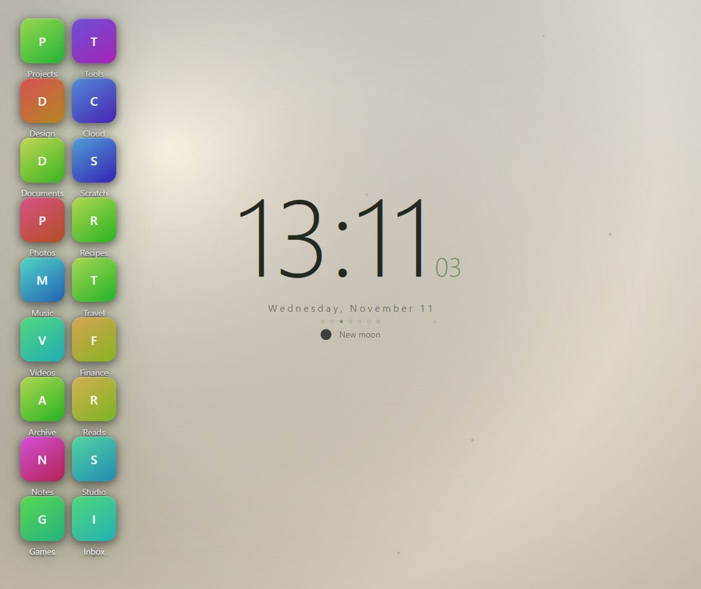
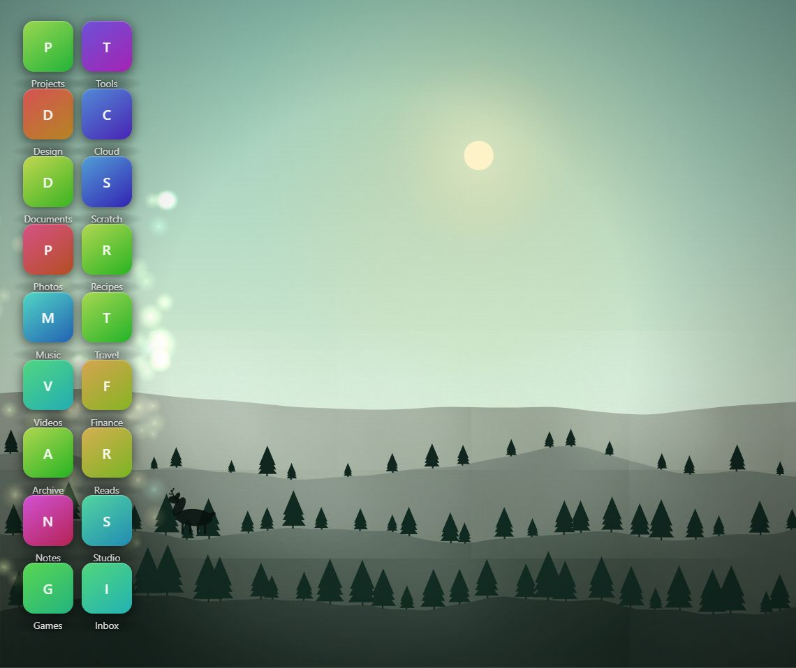
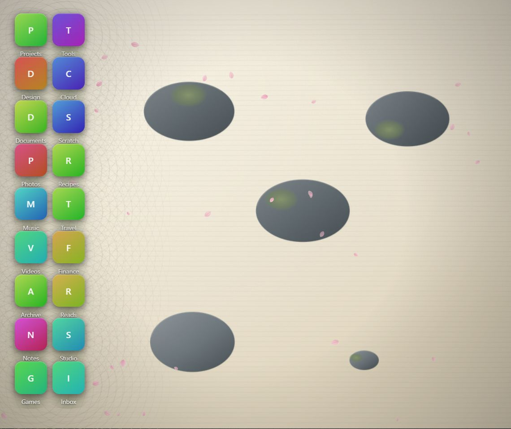
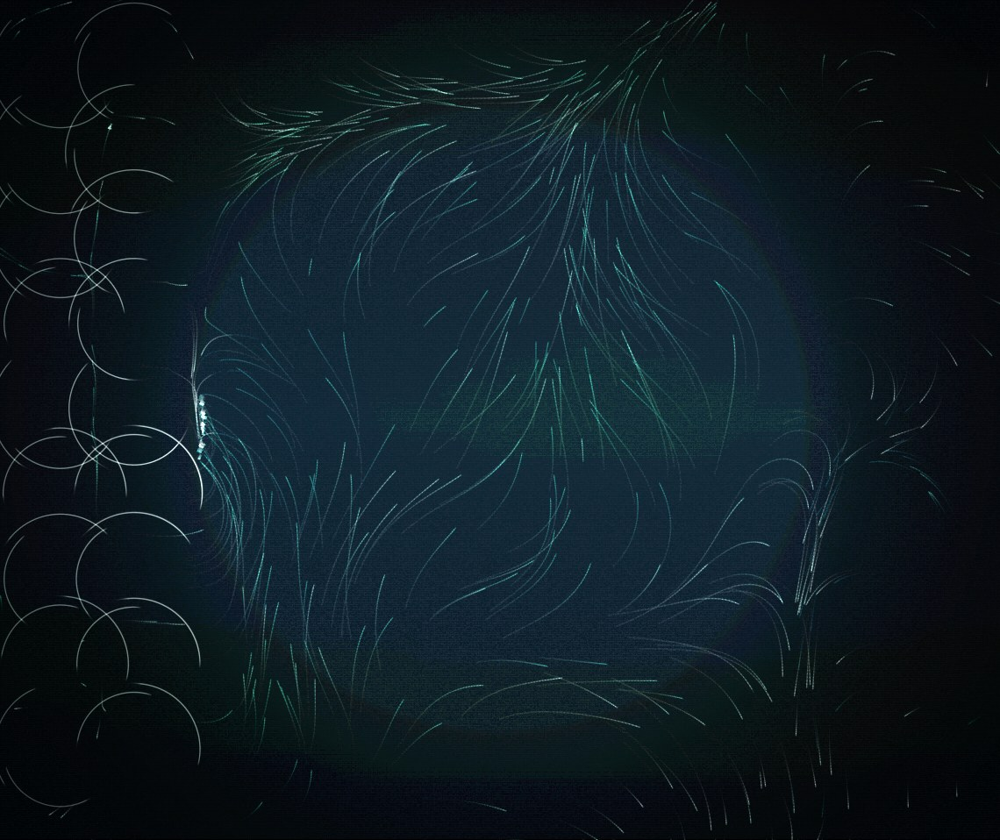
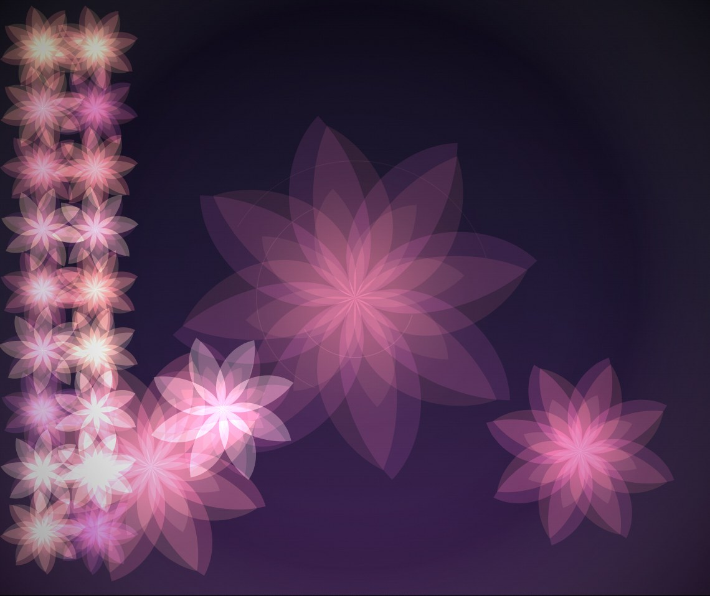
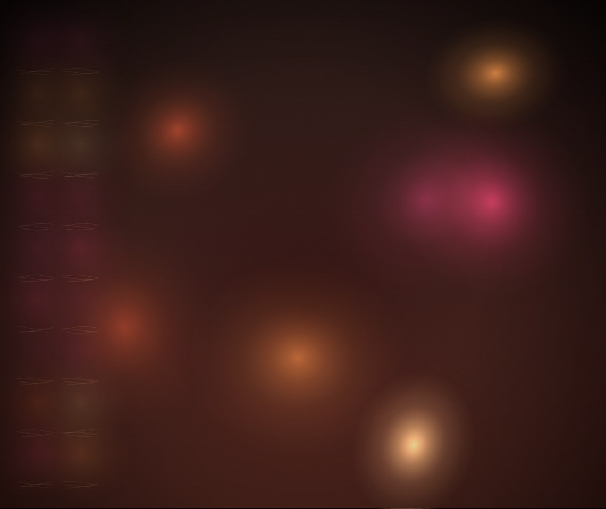
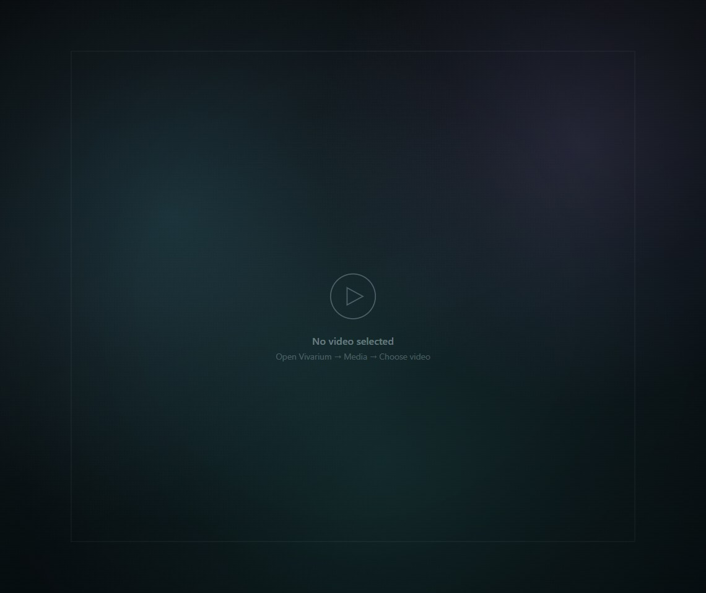
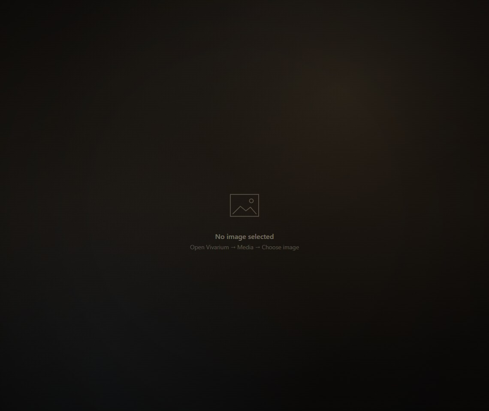
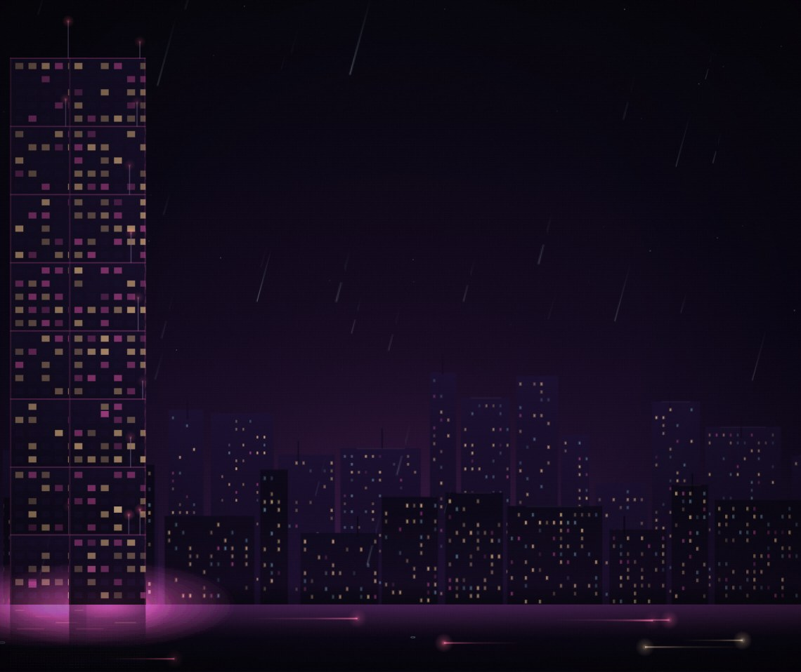
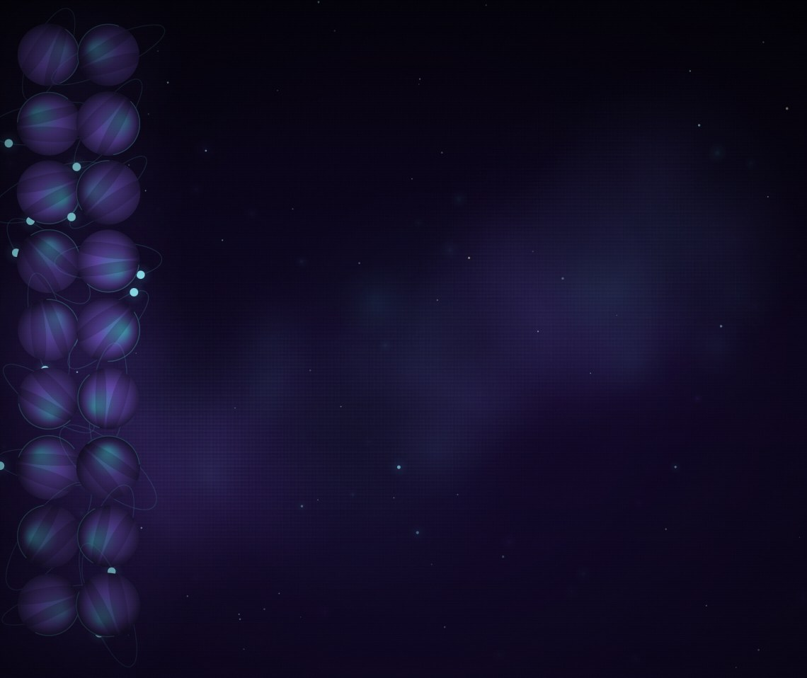

# Vivarium — Adaptive Desktop Wallpaper Engine



A zero-dependency Windows desktop wallpaper engine with **16 original generative, ambient, and media wallpapers** that live behind your desktop icons. Built with the C# compiler that ships with Windows (in-box `csc.exe`), the host is a ~63 KB native executable that hosts Microsoft Edge WebView2 renderers.

## Quick install

```powershell
# From a PowerShell prompt (run once)
powershell -ExecutionPolicy Bypass -File .\install.ps1
```

This creates:
- A desktop shortcut that launches `vivarium.exe`
- A per-user data folder at `%LOCALAPPDATA%\Vivarium\`
- A default `settings.json` if none exists

## Run Vivarium

Launch **Vivarium** from the desktop shortcut, or directly from:

```
dist\Vivarium\vivarium.exe
```

Or from the command line:

```powershell
dist\Vivarium\vivarium.exe          # start wallpaper engine
dist\Vivarium\vivarium.exe --settings  # open settings immediately
dist\Vivarium\vivarium.exe --exit      # quit if already running
```

## Features

| Category | Wallpapers |
|---|---|
| **Landscapes** | Moss Vale, Emberfall, Snowlight, Glow Shores, Coral Drift, Isles |
| **Generative** | Flow Field, Kaleido Bloom, Lava Lamp, Zen Garden |
| **Ambient** | Chrono |
| **Media** | Video wallpaper, Image wallpaper |

### Landscapes
Adaptive scenes that react to the real positions of your desktop icons. Each scene reads icon layout from the live desktop, smooths icon positions with spring physics, and follows a day-night cycle that syncs with your local clock.

### Generative
Purely algorithmic scenes using noise, fractal patterns, and particle systems. Every scene responds to icon positions and has its own parameter knobs (color palettes, motion speed, particle counts).

### Ambient
Minimal ink clock that shows time, date, and moon phase, with a day-reactive palette.

### Media
- **Video**: Plays any local MP4 / WebM / MOV file as a wallpaper, looped and muted, behind icons. Files are read in place; nothing is copied or uploaded.
- **Image**: Turns any still photo into a living wallpaper with a slow Ken Burns pan/zoom drift, film grain, and vignette.

## Settings

Open the settings UI by double-clicking the tray icon, or press **Ctrl+Alt+V** if the hotkey is active.

- **Wallpaper gallery** — 16 scenes with category filters, live preview, per-param controls
- **System** — Startup toggle, FPS selector (24 / 30 / 60), pause in fullscreen, reduce motion
- **Media** — Choose your own video or image wallpaper, clear selections
- **About** — Version, license, source code link, privacy policy

## Privacy

- No telemetry, no account, no network access beyond the two sandboxed local URLs `https://vivarium-video.local` and `https://vivarium-image.local` for reading your own media files
- Icon names are **hashed in memory only** (FNV-1a); no icon text or paths are written to disk or sent anywhere
- Video and image files are read **in place** via WebView2 virtual host mapping; nothing is uploaded or copied
- The only data persisted is `settings.json` in `%LOCALAPPDATA%\Vivarium\`, which contains your wallpaper choice, parameters, and selected media file paths

## Build & hacking

The host compiles with the **in-box C# compiler** (`csc.exe` from .NET Framework 4.x). No .NET SDK, no npm, no external build tools required.

```powershell
# Compile from source
powershell -ExecutionPolicy Bypass -File .\host\build.ps1

# Or skip the dist package
powershell -ExecutionPolicy Bypass -File .\host\build.ps1 -NoDist
```

See `host/build.ps1` for full usage.

## Screenshots

| Moss Vale | Zen Garden | Flow Field |
|---|---|---|
|  |  |  |

| Kaleido Bloom | Lava Lamp | Video |
|---|---|---|
|  |  |  |

| Image | Rain City | Nebula Drift |
|---|---|---|
|  |  |  |

## License

MIT — free and open source. See the `LICENSE` file for full terms.

## Source

https://github.com/harikrishnasetty/vivarium